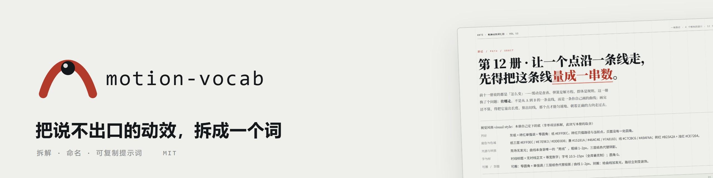

# motion-vocab



**Give the effect you can't describe a name.**

Tell an AI "make it premium, soft, techy" and you get a gray rounded card with a uniform shadow. Tell it "`mask stop 24% → 58%`, `1.1s cubic-bezier(.4,0,.2,1)`, `scale 1 → 1.08`, `opacity .75`" and it lands first try. Adjectives have no anchor; nouns carry parameters. This Skill turns unwritable motion into named, parameterised, bounded terms — then compiles them into booklets you can copy from.

## Install (30 seconds)

```bash
git clone https://github.com/AlphEJ/motion-vocab.git
mkdir -p ~/.claude/skills && cp -r motion-vocab ~/.claude/skills/motion-vocab   # Claude Code
mkdir -p ~/.codex/skills && cp -r motion-vocab ~/.codex/skills/motion-vocab    # Codex
```

Then just say: `use motion-vocab to tear down https://example.com and compile a booklet`

## What it solves

| You say | AI matches | Outcome |
|---|---|---|
| "premium, silky, techy" | nothing specific | the generic AI look |
| "stop 24%→58%, `cubic-bezier(.4,0,.2,1)`, `scale 1→1.08`" | a full set of parameters | right on the first pass |

## Five entries

- **A teardown** — a project / site / video → six-column report, every motion tagged `verified file:line` or `estimated`
- **B survey** — a topic → comparison report, needs ≥5 checkable sources, ≥2 real disagreements, ≥1 run locally
- **A′ booklet** — report → ten-section HTML booklet: 12 term cards, four boundaries, cheat sheet, copy-ready prompts
- **C design** — one request → a page with motion chosen from the vocabulary
- **lookup** — "what's this effect called" → name + parameters + counter-example

## What's inside

`SKILL.md`, `references/` (teardown, booklet, words, intent, survey, sources), `scripts/` (struct, JS, style, overflow, privacy, run_all), `assets/` (2 bundled samples), `booklets/` (2 finished booklets), `docs/INSTALL.md`.

## Verify

```bash
python scripts/run_all.py "booklets/12-路径与轨道词汇册.html" --section 10 --deny-file "scripts/deny-sample.txt"
python scripts/run_all.py "booklets/03-版式与组件词汇册.html" --section 3  --deny-file "scripts/deny-sample.txt" --target-dir "booklets"
```

## Scope and license

Only booklets **03** and **12** ship here; the other 14 stay local with the author. Numbers 1–16 are the author's own booklet numbers — if a number isn't in this repo, treat it as missing, don't guess.

[MIT](LICENSE) — use it, change it, ship it commercially; just keep the copyright notice.

## Author

**@Alpha_领域** on Douyin / Xiaohongshu / WeChat Official Accounts.

